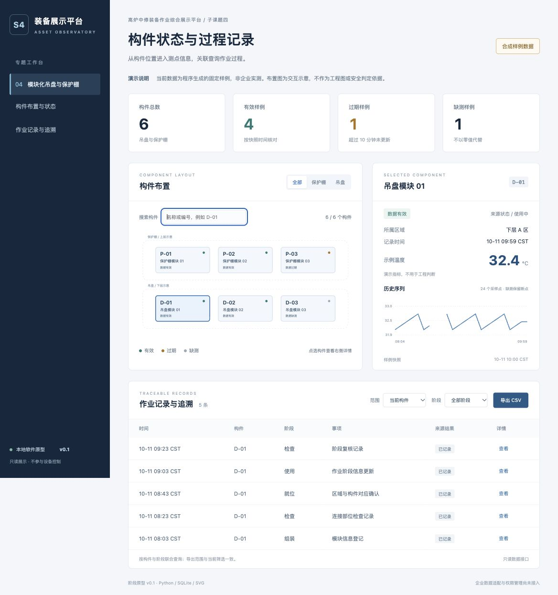
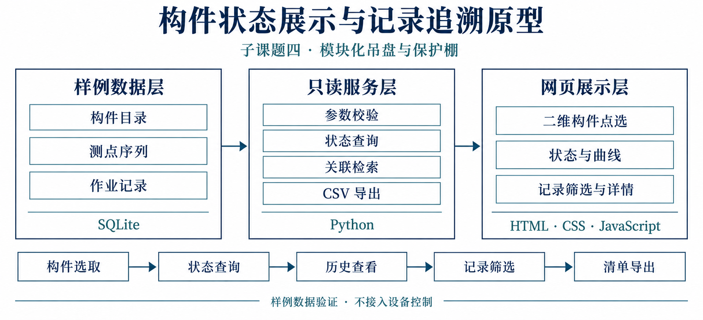

# Industrial Asset Viewer

构件状态展示与记录追溯原型。面向模块化吊盘与保护棚专题，验证“构件选取 → 状态查询 → 历史查看 → 记录筛选 → CSV 导出”的软件流程。

仓库含原创演示代码、程序生成的合成样例和配图，界面中的布局、温度、作业状态与检查结果均为演示内容，不用于工程或安全判断。

## 原型界面

以下为本地运行页面的实际截图，数据为合成样例。



## 模块框架

框架图对应当前代码的数据查询与展示流程，企业系统暂未接入。



图像使用内置图像生成功能绘制，生成提示词保存在 `docs/figure-prompt.txt`。

## 启动

安装 Python 3.10 或以上版本。无第三方运行依赖，无需 npm、GPU 或云服务。

```bash
python3 app.py
```

打开 <http://127.0.0.1:8767>。首次启动自动创建 `runtime/demo.sqlite3`；再次启动保留数据库，不重复生成记录。更换端口：`python3 app.py --port 8768`。按 `Ctrl+C` 停止。

## 可演示的功能

- 六个构件的二维示意、类别筛选、名称/编号搜索与鼠标或键盘选取。
- 通过真实 HTTP 接口和 SQLite 查询读取构件详情，而不是前端硬编码状态。
- 根据固定样例快照区分有效、过期、缺测信息；零值保持有效，空值不替换为零。
- 24 点历史序列，缺测区间断线；过期值明确提示。
- 按构件与作业阶段联合筛选 30 条合成过程记录，查看详情与导出 UTF-8 CSV。
- 只读接口、查询参数校验、CSV 公式转义与静态文件白名单。

快照为 **2026-10-11 10:00（UTC+08:00）**，不是当前现场时间；10 分钟仅用于样例的数据新鲜度判别，不是设备安全阈值。

## 检查

```bash
python3 -m unittest discover -s tests -v
```

测试直接启动临时 HTTP 服务，验证数据来源标识、构件查询、缺测/零值/过期、时间异常、趋势断点、记录筛选与分页、CSV 导出、无效参数、路径限制和只读行为。浏览器验证记录见 `docs/verification.md`。

## 接口

| 路径 | 用途 |
|---|---|
| `GET /api/health` | 健康状态与演示模式 |
| `GET /api/summary` | 构件数量、数据质量、快照时间 |
| `GET /api/assets?group=&q=` | 构件目录与筛选 |
| `GET /api/assets/D-01` | 构件详情 |
| `GET /api/assets/D-01/series` | 历史序列，缺测返回 `null` |
| `GET /api/records?asset_id=&stage=&limit=100&offset=0` | 记录筛选与分页 |
| `GET /api/records.csv?asset_id=&stage=` | 导出全部匹配记录，忽略分页范围 |

## 文件结构

```text
app.py                 HTTP 服务、数据查询及合成样例初始化
static/                网页、交互脚本及样式
tests/test_app.py      自动化接口与数据行为检查
docs/                  架构示意与验证记录
runtime/               本地生成的数据库，不提交 Git
```


后续依据企业确认的构件清单、二维布置和字段字典接入授权数据；完整平台阶段将查询与展示模块纳入统一后端，并补充鉴权和运行管理。本原型不代表四课题整体平台或炉内视觉模块已经完成。

代码仓库按私有项目管理，未授予对外再分发许可。
